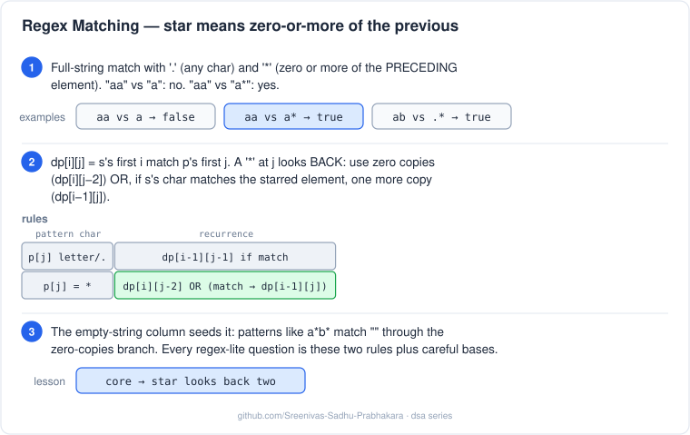

# Regular Expression Matching

> NeetCode 150 · 2-D DP — '*' binds to the element before it and offers exactly two moves: vanish (skip both) or absorb one more character (stay on the pattern). Go, stdlib only, tested.

## Problem

Full-string matching with `.` (any one character) and `*` (zero or more of the *preceding* element). `"aab"` matches `"c*a*b"`. The final boss of the 2-D DP section.

## Approach

`dp[i][j]`: does s's first i match p's first j? Literals and `.` consume one of each (diagonal). All the subtlety is `*`, which is not a token on its own — the unit is the *pair* `x*`, with two possibilities written straight into the recurrence: the pair matches zero characters (`dp[i][j−2]`), or x matches s's current character and the pair stays alive for more (`dp[i−1][j]` — same j, that's the "more" loop). The base row (empty s) is where hand-rolled versions die: `a*b*c*` must match "", seeded by the same skip-the-pair rule. Thompson's NFA construction does this in linear space for real regex engines; the table is the interview form.

**Complexity:** O(n·m) time and space.

## Visual walkthrough

Read the picture top to bottom — each numbered frame is one moment of the algorithm
running on this repo's test example.

## Run

    go test ./...   # verify
    go run .        # demo

---

Part of a 275-repo DSA series in Go — Striver's SDE Sheet (dsa-001–191) plus the NeetCode 150 / Blind 75 additions (dsa-192–275), stdlib only, every solution tested. Browse: [`dsa-*` repos](https://github.com/Sreenivas-Sadhu-Prabhakara?tab=repositories&q=dsa-&type=source).
